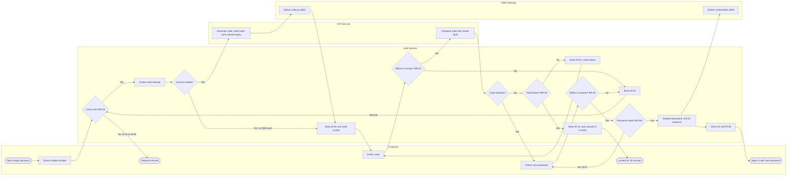

# Process Flow: Password Reset by OTP

**Series:** Systems Analyst Notes  
**Post:** 56  
**Phase:** 7 Process, Compliance and Fintech Reality  
**Author:** Yulia Melekhova  
**Published:** 2026

## Purpose

Draws the reset as a BPMN-style flow across four swim lanes, so the hand-offs between systems are visible. Reach for it when Ops or an integration owner needs to see which system acts at each step and where the customer is left waiting.

---

## How to read it

Mermaid has no BPMN notation, so the diagram borrows the shapes. Each swim lane is a subgraph, a diamond is an exclusive gateway, and a rounded shape is a start or end event. Rule IDs sit inside the gateway they govern.

One path is missing on purpose. When the SMS Gateway rejects a message (E3 in `use-case.md`), the failure is logged and the customer sees nothing different, so it has no branch here.

---

## Diagram

---

## What this diagram leaves out

It shows who acts and in what order, and nothing about what the customer reads or what gets stored. Message wording sits in `wireframe.md`, and field-level storage in `data-mapping.md`.

---

Systems Analyst Notes · [github.com/YuliaMelekhova/systems-analyst-notes](https://github.com/YuliaMelekhova/systems-analyst-notes)

LinkedIn · https://www.linkedin.com/in/yuliamelekhova
