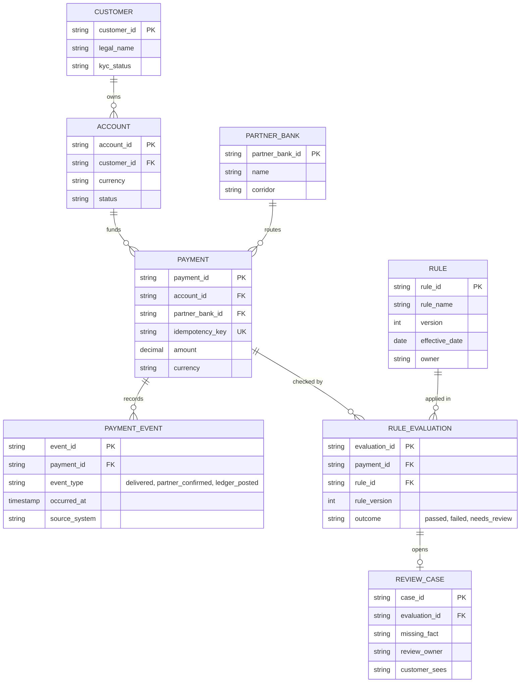

<!-- LinkedIn: https://lnkd.in/p/gQVfz_2F-->

# Payment Platform ER Diagram

**Series:** Systems Analyst Notes  
**Post:** 62  
**Phase:** 8 Scaling  
**Author:** Yulia Melekhova  
**Published:** 2026

## Purpose

Draws the data behind a payment platform's rules as eight entities, so each fact a rule needs has a named home and a named writer. Reach for it when a rule table or a glossary names facts and nobody can say which system stores them.

---

## 1. The diagram

This is a logical model. It shows what the system keeps and how the pieces relate. Indexes, column lengths and storage choices are left out on purpose, and the types are indicative.

---

## 2. How to read a line

Each end of a line carries a symbol that says how many records sit on that side.

| Symbol in the diagram | Reads as | Example here |
|---|---|---|
| `\|\|` | Exactly one | A payment belongs to exactly one account |
| `o\|` | Zero or one | An evaluation opens zero or one review case |
| `o{` | Zero or many | An account funds zero or many payments |
| `PK`, `FK`, `UK` | Primary key, foreign key, unique key | `idempotency_key` is unique within its scope (see question 2) |

---

## 3. What each relationship requires

Every line is a requirement in disguise. Read it aloud, then decide whether the sentence is true for your platform.

| Line | Reads as | Requirement it carries |
|---|---|---|
| CUSTOMER owns ACCOUNT | One customer owns zero or many accounts. An account has exactly one customer. | Which meaning of customer? Check the glossary row before renaming the box. |
| ACCOUNT funds PAYMENT | An account funds zero or many payments. A payment draws on exactly one account. | A payment cannot exist without a funding account. Split funding needs a different shape. |
| PARTNER_BANK routes PAYMENT | A partner bank routes zero or many payments. A payment has exactly one partner bank. | Fallback to a second bank needs a routing attempt entity, which this model does not have. |
| PAYMENT records PAYMENT_EVENT | A payment has zero or many events. An event belongs to exactly one payment. | Each meaning of a shared word is its own row with its own writer. A payment that is delivered and not yet posted is an allowed state. |
| PAYMENT checked by RULE_EVALUATION | A payment has zero or many rule checks. A check runs against exactly one payment. | Every result is stored against the payment it ran on, so it can be replayed. |
| RULE applied in RULE_EVALUATION | A rule appears in zero or many checks. A check applies exactly one rule. | The check keeps `rule_version`, so a later change to the rule does not rewrite history. |
| RULE_EVALUATION opens REVIEW_CASE | A check opens zero or one case. A case belongs to exactly one check. | Only `needs_review` opens a case. The case records the missing fact, an owner and what the customer sees meanwhile. |

---

## 4. One word, three events

The word `settled` is stored as three event types. Each has its own writer and its own proof, taken from the cross-functional glossary.

| `event_type` | Written by (example) | Evidence |
|---|---|---|
| `delivered` | Payments service | `beneficiary_credit_confirmed` event received from the partner bank |
| `partner_confirmed` | Partner gateway | Status code `ACSC` in the partner bank's status message |
| `ledger_posted` | Ledger service | `camt.053` statement entry matched to a ledger posting |

A dashboard reads `delivered`. Engineering reads `partner_confirmed`. Finance reads `ledger_posted`. None of the three teams has to give up its meaning, and none of them can claim the bare word.

---

## 5. Four questions to settle before build

**Question 1: Where does each fact a rule needs live?** For every fact in the rule table, name the entity and the system that writes it. A fact with no box is a requirement gap.

**Question 2: What is the idempotency key unique across?** `idempotency_key` is marked unique in the diagram to keep it readable. In the spec, give it a scope. A common choice is the tenant (or account), plus the operation, plus the key, so the same key from a different customer or a different action cannot collide. Then decide what a repeat returns. The same key with the same payload returns the original response, so a retry looks like the first call. The same key with a different payload is rejected with a conflict (409 or 422) and is not run, since it usually means a client bug or a reused key. To tell the two apart, store a hash of the request next to the key.

**Question 3: What happens when the partner bank confirms twice?** Decide whether a repeat confirmation creates a second event row or is dropped, and which field detects it.

**Question 4: Which "exactly one" lines are optional in practice?** Test each one against real data. Can a payment arrive before its account is verified? Can an event arrive before its payment is stored?

---

## 6. How to adapt it

Rename the entities to yours and keep four things:

* Separate event rows for each meaning of a shared word, with a writer recorded on every event
* A version on every rule evaluation
* The third outcome, `needs_review`, with a case that names the missing fact and an owner
* One `UK` key, scoped to tenant and operation, that makes a retried request safe to repeat

Replace `CUSTOMER` with the meaning your rules use. The glossary lists three, and a model that picks none of them will drift.

---

## Related Artifacts

* [artifacts/post-60-cross-functional-glossary.csv](https://github.com/YuliaMelekhova/systems-analyst-notes/blob/main/artifacts/post-60-cross-functional-glossary.csv) - The three meanings of settled that become three event types here
* [artifacts/post-58-decision-table-template.md](https://github.com/YuliaMelekhova/systems-analyst-notes/blob/main/artifacts/post-58-decision-table-template.md) - The rule table whose needed facts each need a box on this diagram
* [artifacts/post-25-sequence-diagram.md](https://github.com/YuliaMelekhova/systems-analyst-notes/blob/main/artifacts/post-25-sequence-diagram.md) - Where the idempotency key and the late confirmation first appear
* [artifacts/post-49-c4-diagrams/](https://github.com/YuliaMelekhova/systems-analyst-notes/tree/main/artifacts/post-49-c4-diagrams/) - The containers this data model has to fit inside
* [artifacts/post-22-api-contract-template.yaml](https://github.com/YuliaMelekhova/systems-analyst-notes/blob/main/artifacts/post-22-api-contract-template.yaml) - The contract that carries these fields on the wire

---

Systems Analyst Notes · [github.com/YuliaMelekhova/systems-analyst-notes](https://github.com/YuliaMelekhova/systems-analyst-notes)

LinkedIn · https://www.linkedin.com/in/yuliamelekhova
